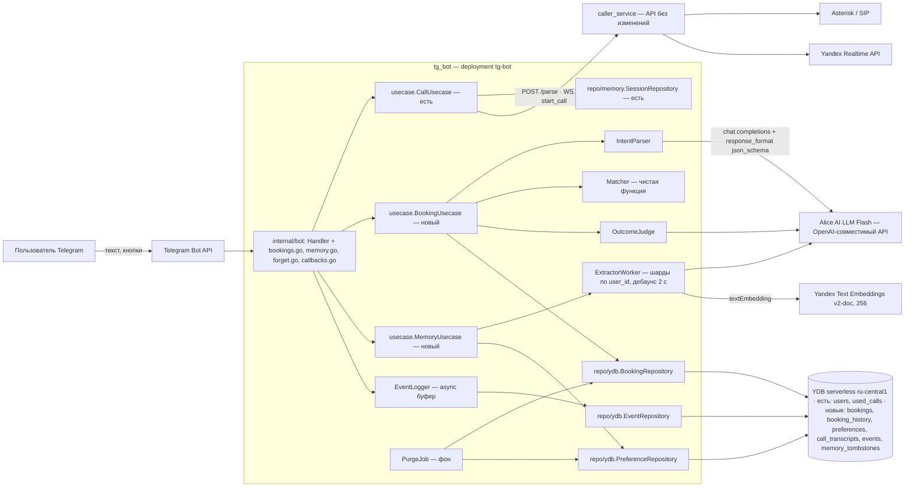
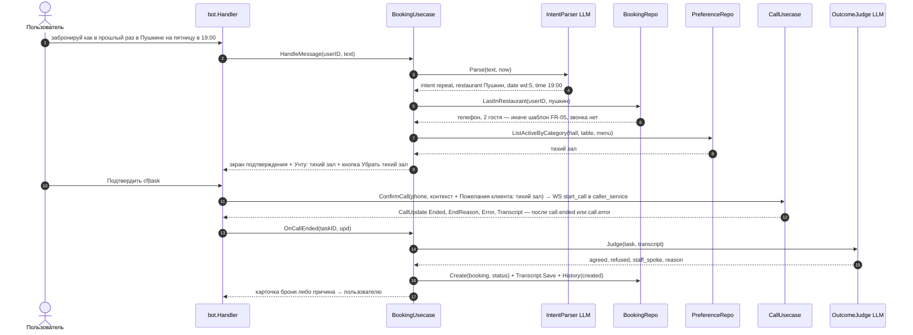
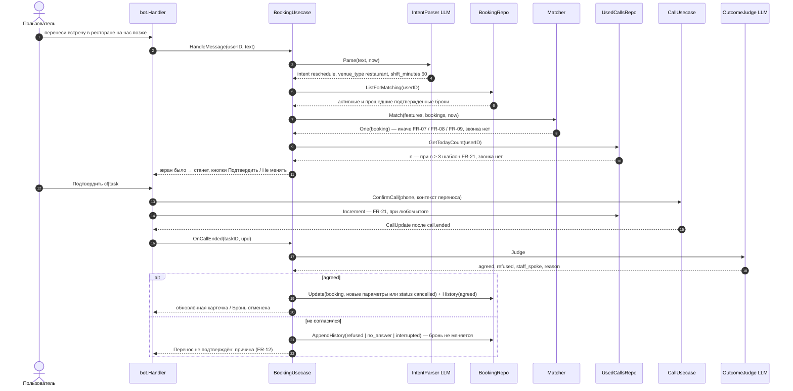
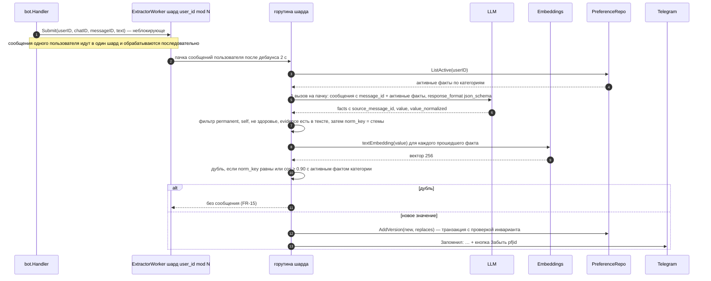

Как реализовать требования 2.2_SRS (FR-01…FR-22, NFR-01…NFR-09) поверх кода ветки `main`. Обоснования и источники — в `research.md` (решения D-1…D-16); здесь только принятые решения. Пути к файлам — от корня репозитория.

# 1. Контекст и границы

| Область | Как устроено в коде сейчас | Что делаем |
|---|---|---|
| Сессия диалога | `tg_bot/internal/repo/memory/session.go` — `map[int64]*entity.Session` под `sync.RWMutex`; `entity.Session` хранит `State` (`idle` / `awaiting_confirmation`), `PendingMessage`, `PendingPhone`, `PendingContext`, `Organization`; теряется при рестарте пода | §2.2 |
| Хранилище | YDB serverless; `tg_bot/internal/repo/ydb/client.go`: `Client.EnsureTables` создаёт `users(user_id, name, phone, interactive_mode)` и `used_calls(user_id, count, drop_timestamp)` через `ExecuteSchemeQuery`, `ensureColumn` — идемпотентный `ALTER`; запросы — `table.Session.Execute` с `DECLARE`/`UPSERT` | §3 |
| Лимит звонков | `tg_bot/internal/bot/handler.go`: `dailyCallLimit = 3`, `limitText`; `usedCalls.GetTodayCount` в `onMessage` и `onConfirm`, `Increment` после `ConfirmCall`; сутки по `moscowLoc = time.FixedZone("UTC+3", …)` в `repo/ydb/used_calls.go`; `/droplimits` по whitelist телефонов | §6.1 |
| Старт звонка | `usecase.CallUsecase.HandleMessage` → `caller.Client.Parse` (`POST /parse` caller_service: YandexGPT-lite с XML-тегами + `orgsearch` через Search API, 1 RPS, 3 попытки × 1,5 с, таймаут 25 с) → `awaiting_confirmation`; `ConfirmCall` → `caller.Client.StartCall`: WebSocket `/ws`, `start_call {phone_number, text, interactive}`, ожидание `call.started` | §4.1, §4.2 |
| Итог звонка | `usecase.watchEvents` сворачивает `yandex.input_transcript`, `yandex.text_delta`/`response_done`, `call.ended {reason}`, `call.error` в `CallUpdate{Transcript, Ended, EndReason, Error}`; причины `call.ended` в `caller_service/internal/service/call_service.go`: `farewell`, `abonent_hangup`, `timeout` (300 с), `cancelled`. После первого `call.error` читатель в `tg_bot/internal/caller/client.go:175` закрывает соединение, поэтому в tg_bot такой звонок виден как `Ended = true, EndReason = "", Error != ""` (так приходит и `audiosocket timeout`). **Признака согласия ресторана caller_service не возвращает** (вопреки D-1 SRS), транскрипт не хранит | §4.1, Р-3 |
| LLM в tg_bot | Отсутствует. Единственный LLM-код — `caller_service/internal/parser/parser.go` (Text Generation API, host `llm.api.cloud.yandex.net`) и tool `ask_principal` в `caller_service/pkg/yandex/realtime.go` (Realtime API) | §2.1, §5.2 |
| Конфиг | `tg_bot/config/config.go`: `BOT_TOKEN`, `CALLER_SERVICE_URL`, `YDB_DSN`, `YDB_SA_KEY_FILE`; `tg_bot/Dockerfile`: `TZ=Europe/Moscow` | §2.3 |
| Инфраструктура | `infra/terraform/kubernetes.tf`: deployment `tg-bot` (1 реплика, Telegram через `HTTP_PROXY`), секрет `ydb-sa-key` из `var.ydb_sa_key_json` — **сервисный аккаунт этого ключа в Terraform не описан**; `YDB_DSN = grpcs://ydb.serverless.yandexcloud.net:2135/ru-central1/…`; **база YDB ресурсом Terraform не описана**; `k8s_sa` имеет роль `editor` на весь фолдер | §7.7, §9.3 |

Scope SRS 1.2 покрывается компонентами §2.1 и трассировкой §8. Вне границ (SRS 1.2 «не входит»): брони без бота, API ресторанов, рекомендации, здоровье и другие люди, другие поручения, групповые брони. caller_service, Asterisk и Realtime API не меняются.

# 2. Архитектура

## 2.1. Компоненты



| Компонент | Пакет | Ответственность |
|---|---|---|
| `bot.Handler` (есть) + `bookings.go`, `memory.go`, `forget.go`, `callbacks.go`, `templates.go` | `tg_bot/internal/bot` | команды, callback-кнопки (`c.Respond()` на каждую), шаблоны (§5.4), таймауты, `MemoryUsecase.Submit` |
| `IntentParser` | `tg_bot/internal/usecase/intent.go`, реализация `tg_bot/internal/llm/chat.go` | один вызов LLM на сообщение: тип поручения, слоты, признаки поиска (§5.2 а); назначение `разбор фразы` |
| `Matcher` | `tg_bot/internal/usecase/matcher.go` | детерминированный выбор брони (FR-06), без I/O |
| `BookingUsecase` | `tg_bot/internal/usecase/booking.go` | повтор (FR-05), перенос/отмена (FR-06…FR-12), сохранение брони по итогу (FR-01, FR-02), «Учту:» (FR-16); активные звонки — в `live sync.Map[taskID]*Task` (по образцу `CallUsecase.live`), а не в сессии, чтобы новое сообщение во время звонка не затёрло поручение |
| `OutcomeJudge` | `tg_bot/internal/usecase/outcome.go` + `llm` | по транскрипту: согласился / отказал / ни то ни другое (§4.1, §5.2 в) |
| `MemoryUsecase` + `ExtractorWorker` | `tg_bot/internal/usecase/memory.go`, `extractor_worker.go` | фоновое извлечение (FR-13…FR-15), «Забыть» / «Исправить» / «Удалить», очистка (FR-18, FR-19) |
| `Embedder`, `EventLogger`, `PurgeJob` | `tg_bot/internal/llm/embeddings.go`, `usecase/events.go` + `repo/ydb/event.go`, `usecase/purge.go` | `textEmbedding` и косинус в Go; неблокирующая запись событий FR-22 пачками; физическое удаление по `memory_tombstones` (NFR-04) |
| `repo/ydb.*` | `tg_bot/internal/repo/ydb/{booking,booking_history,preference,transcript,event,eraser}.go` | YQL; каждый запрос с `user_id` (NFR-03); чтения через `db.Query().Do` с таймаутом 2 с и одним повтором (`query.WithIdempotent()`) |
| `cmd/main.go` | есть | + `llm.NewClient`, новые репозитории, `ExtractorWorker.Start`, `PurgeJob.Start`, `EventLogger.Start` |

Слои как в текущем tg_bot: `domain/entity` и `domain/repo` (интерфейсы, §5.1) ← `usecase` ← `repo/ydb`, `repo/memory`, `llm`, `caller` ← `bot`, `cmd`.

## 2.2. Состояние поручения

`entity.Session` получает поле `Task *entity.Task`; на время звонка `Task` копируется в `BookingUsecase.live` по `task_id`:

```go
type TaskType string // new_booking | repeat | reschedule | cancel

type BookingDraft struct { Restaurant, RestaurantNorm, Phone, VenueType string; StartsAt time.Time; Guests uint32; Preferences []string; Context string }
type Task struct {
    ID        string; Type TaskType           // ULID, идёт в callback_data (§5.3)
    State     TaskState                       // collecting_slots | choosing_booking | awaiting_confirmation | calling
    BookingID string; Candidates []string     // repeat / reschedule / cancel; booking_id для FR-07
    Draft     BookingDraft; NewParams *BookingDraft   // «было» или новая бронь; «станет» для переноса
    AppliedPref, ExcludedPref []string        // pref_id в строке «Учту:»; после «Убрать …» (FR-16)
    StartedAt time.Time                       // task_started → task_confirmed (M-1)
}
```

Сессия остаётся в памяти процесса (одна реплика tg-bot): при рестарте теряется только неподтверждённое поручение, брони и факты — в YDB (NFR-02).

## 2.3. Конфигурация

Новые переменные в `tg_bot/config/config.go` и в `kubernetes_deployment.tg_bot`:

| Переменная | Назначение | По умолчанию |
|---|---|---|
| `YC_API_KEY`, `YC_FOLDER_ID` | ключ сервисного аккаунта с ролью `ai.languageModels.user` | обязательны при `MEMORY_ENABLED=true` |
| `LLM_BASE_URL` | OpenAI-совместимый API AI Studio | `https://ai.api.cloud.yandex.net/v1` |
| `LLM_MODEL_URI` | LLM для разбора фразы, извлечения пожеланий и итога звонка — Alice AI LLM Flash; резерв при провале eval-набора — YandexGPT Pro 5.1 `gpt://<folder>/yandexgpt-5.1` через тот же API[^models] | `gpt://<folder>/aliceai-llm-flash` |
| `EMB_MODEL_URI` | эмбеддинги, 256 измерений, одна модель для обеих сторон сравнения[^emb] | `emb://<folder>/text-embeddings-v2-doc` |
| `MEMORY_ENABLED` | фича-флаг; `false` — поведение текущего бота | `true` |
| `MEMORY_LLM_TIMEOUT`, `MEMORY_YDB_TIMEOUT` | таймауты пути запроса (NFR-02, D-15) | `5s`, `2s` |
| `EXTRACTOR_SHARDS`, `EXTRACTOR_QUEUE`, `EXTRACTOR_DEBOUNCE` | шарды экстрактора, ёмкость очереди шарда, окно дебаунса | `4`, `256`, `2s` |
| `DEDUP_COS_THRESHOLD` | порог косинусной близости дубля | `0.90` |

## 2.4. Коды хранения и термины SRS

| Поле | Код в YDB / событиях | Термин SRS |
|---|---|---|
| `task_type` | `new_booking` / `repeat` / `reschedule` / `cancel` | новая бронь / повтор / перенос / отмена |
| `bookings.status` | `confirmed` / `rejected` / `no_answer` / `cancelled` | подтверждена / отклонена / не дозвонились / отменена |
| `booking_history.outcome` | `agreed` / `refused` / `no_answer` / `interrupted` | согласие / отказ / не ответил / разговор прервался |
| `preferences.category` | `hall` / `table` / `time` / `menu` | зал / стол / время / меню |
| `preferences.source_type` | `message` / `manual` | цитата сообщения / «исправлено вручную» |
| `llm_call.purpose` | `memory` / `parse` / `outcome` | память / разбор фразы / итог звонка (расширение FR-22, §9.2) |
| `response_latency_ms.kind` | `confirmation_screen` / `other` | экран подтверждения / другое |
| `events.user_key` | `u:<user_id>` → после `/forget` `anon:<random>` | `user_id` / обезличенный идентификатор |

# 3. Модель данных (YDB)

Правила: первичный ключ каждой пользовательской таблицы начинается с `user_id`, все запросы содержат `WHERE user_id = $user_id` (NFR-03); идентификаторы — ULID, 26 символов (`github.com/oklog/ulid/v2`, `ulid.Make()`)[^ulid]; время — `Timestamp` в UTC, рядом локальная дата `Date` для сравнения «сегодня / завтра / день недели» (D-16); все вычисления дат — через `time.LoadLocation("Europe/Moscow")`, а не `FixedZone`, как в `used_calls.go`. Удаление пользователя — мягкое (`deleted_at`, `purge_at`) + TTL + `PurgeJob` (§3.6). Таблицы создаются в `Client.EnsureTables` по текущему паттерну; у всех пользовательских таблиц `ALTER TABLE … SET (TTL = Interval("PT0S") ON purge_at)`[^ttl].

## 3.1. `bookings` (FR-01, FR-03, FR-05)

```sql
CREATE TABLE bookings (
    user_id Int64, booking_id Utf8, restaurant_name Utf8, restaurant_norm Utf8, restaurant_phone Utf8,
    venue_type Utf8,                                  -- restaurant | cafe | bar | unknown
    starts_at Timestamp, starts_at_local Date,        -- UTC + дата в Europe/Moscow для Matcher и FR-08
    guests Uint32, user_name Utf8, preferences Json,  -- снимок подставленных фактов
    status Utf8, last_call_id Utf8, created_at Timestamp, updated_at Timestamp, deleted_at Timestamp, purge_at Timestamp,
    PRIMARY KEY (user_id, booking_id)
);
```

«Активная бронь» = `status = 'confirmed' AND starts_at > now AND deleted_at IS NULL`, вычисляется в запросе. Индексов нет: чтение по префиксу PK, сортировка в Go; при росте числа броней — индекс `(user_id, starts_at)`.

## 3.2. `booking_history` (FR-02, FR-04, FR-12)

```sql
CREATE TABLE booking_history (
    user_id Int64, booking_id Utf8, entry_id Utf8,    -- ULID: ORDER BY entry_id DESC = новые сверху
    action Utf8,                                      -- created | reschedule | cancel (HistoryAction)
    old_params Json, new_params Json, call_id Utf8,
    outcome Utf8, outcome_reason Utf8,                -- agreed | refused | no_answer | interrupted по §4.1; причина отказа (FR-12)
    created_at Timestamp, purge_at Timestamp,
    PRIMARY KEY (user_id, booking_id, entry_id)
);
```

Строки истории не обновляются; запись добавляется при каждой попытке, успешной или нет.

## 3.3. `preferences` (FR-14, FR-15, FR-18, FR-20)

```sql
CREATE TABLE preferences (
    user_id Int64, pref_id Utf8, fact_key Utf8, version Uint32,  -- fact_key — линия версий одного факта
    category Utf8, value Utf8,                                   -- «тихий зал»
    value_normalized Utf8, norm_key Utf8,                        -- начальная форма от LLM (D-3); стемы Snowball russian — ключ точного совпадения
    embedding String,                                            -- Knn::ToBinaryStringFloat + Untag, 256 float
    source_type Utf8, source_ref Utf8, source_quote Utf8,        -- "<chat_id>:<message_id>", цитата ≤ 100 символов
    is_active Bool, replaced_by Utf8, created_at Timestamp, deleted_at Timestamp, purge_at Timestamp,
    PRIMARY KEY (user_id, pref_id)
);
```

Инварианты: у `fact_key` не больше одной активной версии (проверяется внутри транзакции `AddVersion`, §4.3); `hall/table/time` — одна активная линия на категорию, `menu` — несколько. Эмбеддинг лежит в строке факта и удаляется вместе с ней; формат Knn[^knn] — чтобы при необходимости считать близость в YQL, на пилоте косинус считается в Go. Индексов нет (≤ 50 строк по префиксу PK).

## 3.4. `call_transcripts`, `memory_tombstones`

`call_transcripts (user_id, call_id, booking_id, task_id, task_type, transcript Json, end_reason Utf8, summary Utf8, created_at, deleted_at, purge_at; PK (user_id, call_id))` — транскрипт из `CallUpdate.Transcript` и причина `end_reason ∈ {farewell, abonent_hangup, timeout, cancelled, error}`; признак согласия хранится только в `booking_history.outcome`.

`memory_tombstones (user_id Int64, requested_at Timestamp; PK (user_id))` — заявка на очистку для `PurgeJob`; обезличенный `user_key` в ней не хранится, строка удаляется сразу после подтверждения очистки (`COUNT = 0` во всех таблицах), поэтому связь `user_id` → `anon:…` восстановить нельзя.

## 3.5. `events` (FR-22)

```sql
CREATE TABLE events (
    event_id Utf8, ts Timestamp, user_key Utf8,       -- "u:<user_id>", после /forget "anon:<random>"
    event_type Utf8, task_id Utf8, task_type Utf8, booking_id Utf8, attrs Json,
    INDEX idx_events_user GLOBAL SYNC ON (user_key),
    PRIMARY KEY (event_id)
);
```

События не удаляются и без TTL — это данные метрик. Синхронный индекс[^idx] нужен только для обезличивания при `/forget` (ASYNC-индекс нельзя читать в RW-транзакции).

## 3.6. Удаление и физическая очистка (FR-19, NFR-04)

| Шаг | Когда | Что происходит |
|---|---|---|
| 1. Мягкое удаление | «Удалить всё», одна транзакция | `UPDATE bookings / booking_history / preferences / call_transcripts SET deleted_at = $now, purge_at = $now WHERE user_id = $uid`; `UPSERT memory_tombstones`. Все чтения фильтруют `deleted_at IS NULL` — через 5 с данных не видно |
| 2. Обезличивание событий | сразу после шага 1, пачками | `UPDATE events ON SELECT event_id, $anon AS user_key FROM events VIEW idx_events_user WHERE user_key = $uk`; `$anon = "anon:" + случайные 16 байт`, нигде не сохраняется |
| 3. TTL | фон YDB | `Interval("PT0S") ON purge_at`: строки удаляются при следующем проходе фоновой операции (по умолчанию раз в час; `NULL` не трогается; точный момент не гарантирован)[^ttl] |
| 4. `PurgeJob` | при старте пода и каждые 6 ч | по каждой `memory_tombstones` без `purged_at`: явный `DELETE … WHERE user_id = $uid` по четырём таблицам, затем `SELECT COUNT(*)`; при нулях — `purged_at`, затем удаление самой заявки. Гарантирует ≤ 24 ч независимо от TTL |

Точечные удаления (FR-14 «Забыть», FR-18 «Удалить») — мягкие: версия получает `deleted_at` и `purge_at = now`, из всех выборок исключается сразу, физически стирается тем же TTL + `PurgeJob`. Для пользователя это удаление (FR-14, FR-18), а аудит и откат записи сохраняются (OWASP ASI06, research §3).

# 4. Основные потоки

## 4.1. Новая бронь и повтор: «Учту:», сохранение по итогу звонка (FR-01, FR-05, FR-16)



Ветки, не показанные на диаграмме: `intent = new_booking` → существующий `CallUsecase.HandleMessage` с `/parse`, затем те же шаги с «Учту:»; нет даты или времени для повтора → вопрос «На какую дату?» / «На какое время?» с кнопкой `ts|task|HHMM` из факта категории `время` (FR-05); «Убрать [факт]» (`px|task|pref`) убирает факт из `Task.AppliedPref` в `ExcludedPref`, экран перерисовывается, событие `preference_excluded`; `cancelled` → бронь не сохраняется.

Статус и сообщение определяются в `BookingUsecase.OnCallEnded` по `CallUpdate` и ответу `OutcomeJudge` (один вызов LLM по транскрипту, назначение `итог звонка`, схема §5.2 в) — одинаково для новой брони, повтора, переноса и отмены:

| Условие (проверяется сверху вниз) | Новая бронь / повтор | Перенос / отмена (FR-12) | `history.outcome` |
|---|---|---|---|
| `EndReason = cancelled` | бронь не сохраняется | запись в историю не создаётся | — |
| `EndReason = timeout` или `Error != ""` (в т. ч. `audiosocket timeout`) | `не дозвонились`, «Не дозвонились» | «… не подтверждён: ресторан не ответил» | `no_answer` |
| `agreed = true` | `подтверждена`, карточка | бронь обновлена, карточка / «Бронь отменена» | `agreed` |
| `refused = true` | `отклонена`, «Ресторан отказал (reason)» | «… не подтверждён: ресторан отказал (reason)» | `refused` |
| иначе: `abonent_hangup`, или `farewell` без явного согласия/отказа, или `staff_spoke = false` | `не дозвонились`, «Разговор прервался» | «… не подтверждён: разговор прервался» | `interrupted` |

**Решение Р-3.** Согласие определяется в tg_bot по транскрипту; `agreed`/`refused` требуют явной реплики ресторана, при сомнении оба `false` → «разговор прервался» (SRS 1.2: статус только по ответу ресторана). Альтернатива — событие `call.summary` в caller_service — отложена; вернуться к ней, если на ручной разметке G-1 точность оценки окажется < 95 %.

Контекст звонка для повтора собирается шаблоном без `/parse`: «Забронируй столик в {restaurant} на {дата} в {время} на {guests} человек. Пожелания клиента: {список}»; имя клиента добавляется, как сейчас в `CallUsecase.ConfirmCall`.

## 4.2. Перенос и отмена одной фразой (FR-06…FR-12, FR-21)



«Не менять» (`cx|task`) → `CancelTask`, звонка нет. `Several` → «Какую бронь?» с кнопкой `bs|task|booking` на каждую (FR-07), после выбора — проверка лимита и экран; `Past` → шаблон FR-08; `None` → FR-09; эти ответы лимит не тратят.

**Matcher (FR-06).** Бронь подходит, если совпадают все названные признаки:

| Признак | Сравнение |
|---|---|
| название ресторана | `restaurant_norm` содержит стемы токенов фразы или расстояние Левенштейна ≤ 2 на токен («Пушкине» → «пушкин») |
| тип заведения | равен `venue_type`; `unknown` считается подходящим (тип заполняется при создании из фразы и `display_name` ответа `/parse`) |
| дата | ссылка от `IntentParser` (`today`, `tomorrow`, `wd:1..7`, `d:дд.мм`) резолвится в Europe/Moscow: `wd:N` — ближайший такой день ≥ сегодня, `d:дд.мм` — ближайшая такая дата ≥ сегодня (для поиска прошедших — также текущий год назад); сравнение со `starts_at_local` |
| время | `HH:MM` точно; время после «на» в команде переноса — `new_time`, а не признак поиска |

Ветки: активных совпадений 1 → `One`; ≥ 2 → `Several`; 0 активных, но есть `confirmed` с `starts_at < now` → `Past` (последняя по дате); иначе `None`. Без признаков во фразе: одна активная → `One`, несколько → `Several`. Новые параметры (FR-10): `new_date`/`new_time` как есть, `shift_minutes` прибавляется к `starts_at`.

Контекст звонка: «У клиента есть бронь в {restaurant} на {дата} {время} на {guests} человек на имя {имя}. Нужно перенести её на {новая дата} {новое время} (или: отменить). Если ресторан согласен — подтверди новые параметры вслух; если нет — узнай причину. Пожелания клиента: {список}». Это обычный `text` команды `start_call`.

**Решение Р-1 (порядок вызовов).** `IntentParser` всегда первый; `/parse` caller_service вызывается только при `intent ∈ {new_booking, other}` — последовательно, не параллельно: Search API в `orgsearch` ограничен 1 RPS (`caller_service/internal/orgsearch/search.go:19-20`), лишние `/parse` на повторных поручениях упёрлись бы в него. Цена — ≈ 1 с к экрану новой брони, путь которой и так определяется `/parse` (LLM + веб-поиск с ретраями 3 × 1,5 с, таймаут 25 с). Следствие: для `new_booking` критерий NFR-01 «≤ 3 с p95» существующим `/parse` не достигается и до фичи — см. §7.1 и поправку П-3.

## 4.3. Фоновое извлечение пожеланий (FR-13…FR-15, NFR-06, NFR-07)



- **Очередь и порядок.** `Submit` кладёт сообщение в шард `user_id mod EXTRACTOR_SHARDS`; у шарда одна горутина, поэтому два сообщения одного пользователя никогда не обрабатываются параллельно. Дебаунс 2 с (D-7): сообщения, пришедшие в окно, объединяются в одну пачку и один вызов LLM. Команды (`/…`), ответы на уточнения звонка и текст в состоянии «Исправить» в очередь не попадают. При переполнении шарда — событие `extractor_dropped`.
- **Один вызов и повтор.** На пачку — один вызов назначения `память`; при транспортной ошибке или невалидном JSON — один повтор, учитывается как `attempts = 2` того же события `llm_call`; дальше `extractor_failed`, пачка теряется (recall ≥ 70 % допускает).
- **Промпт.** В запрос идут только тексты пользователя (не транскрипты и не ответы ресторана, D-8) с `message_id`, плюс активные факты пользователя по категориям — чтобы модель формулировала `value` в тех же терминах; решение «дубль / замена» модель не принимает (нет поля `action`), его принимает Go.
- **Фильтр** (precision, NFR-06): `permanence = permanent` ∧ `subject = self` ∧ `health = false` ∧ `category ≠ другое` ∧ `evidence` встречается в сообщении `source_message_id`. «В этот раз на веранде» → `one_time`, «аллергия на орехи» → `health`, «мама любит у окна» → `other_person`.
- **Дубль** (FR-15): `norm_key` (стемы `kljensen/snowball` russian по `value_normalized`) совпадает с активным фактом категории, либо косинус эмбеддингов ≥ `DEDUP_COS_THRESHOLD` (0.90) — сообщение не отправляется. Чтение активных фактов — `SerializableRW`/`OnlineRO`, не `StaleReadOnly`, чтобы не читать устаревшее состояние. Эскалация при ложных склейках на eval-наборе — `gomorphy` вместо стемов (D-3).
- **Версия.** `hall/table/time` — `AddVersion(new, replaces = активная)`: вставка новой версии, `is_active = false`, `replaced_by = new` у старой, и проверка `SELECT COUNT(*) … WHERE user_id = $uid AND fact_key = $k AND is_active AND pref_id <> $new` внутри той же транзакции — при ≠ 0 транзакция откатывается с `ErrVersionConflict` и пачка повторяется один раз; сериализуемая транзакция YDB сама обнаружит конфликт чтение-запись, проверка страхующая. `menu` — `AddVersion(new, replaces = "")`, новый `fact_key`. `source_ref = "<chat_id>:<source_message_id>"`, `source_quote` — ≤ 100 символов этого сообщения.
- **«Запомнил».** Одно сообщение на пачку: «Запомнил: тихий зал, у окна» с кнопкой «Забыть» на каждый факт; после нажатия сообщение редактируется. `ForgetVersion` мягко удаляет версию (`deleted_at`, см. §3.6) и делает активной предшественницу, если она есть (FR-14).

## 4.4. Команды `/bookings`, `/memory`, `/forget` (FR-03, FR-04, FR-17…FR-19)

| Команда / кнопка | Запрос (всегда с `user_id`) | Ответ |
|---|---|---|
| `/bookings` | `ListActive`, сортировка по `starts_at` в Go | строка на бронь: ресторан, дата, время, гости, статус; кнопка «Подробнее» `bk\|id`; пусто → «Активных броней нет» |
| «Подробнее» | `Get` + `History` (`ORDER BY entry_id DESC`) | карточка со всеми полями и историей («19:00 → 20:00», дата, итог звонка); чужой или несуществующий id → шаблон FR-09 |
| `/memory` | `PreferenceRepository.ListActive` | по факту: категория, значение, дата, источник (цитата ≤ 100 символов + «…» или «исправлено вручную»); кнопки «Исправить» `pe\|id`, «Удалить» `pd\|id`; страницы по 10 фактов, кнопки «‹» / «›» (`pg\|N`) через `editMessageText` — 50 фактов не влезают в 4 096 символов и 100 кнопок; пусто → «Я пока ничего о вас не запомнил» |
| «Исправить» | `State = editing_pref(id)`; следующий текст → `AddVersion(value, manual, replaces = id)` | «Исправлено: второй этаж»; этот текст в экстрактор не идёт |
| «Удалить» | `DeleteFact(user_id, fact_key)` — все версии | «Удалено»; чужой id → «Такого факта нет» |
| `/forget` | `CountActive` | шаблон FR-19 с N; кнопки «Удалить всё» `fa\|nonce` / «Не удалять» `fn\|nonce` |
| «Удалить всё» | `MemoryEraser.EraseUser` (§3.6, шаги 1–2) | «Память очищена»; событие `memory_cleared` пишется до обезличивания |

# 5. Контракты

## 5.1. Go-интерфейсы

Сущности `Booking`, `BookingChange`, `Preference`, `CallTranscript`, `Event` повторяют колонки §3 (`BookingChange.Action` — отдельный тип `HistoryAction string // created | reschedule | cancel`, не `TaskType`). Репозитории (`tg_bot/internal/domain/repo`):

```go
var ErrBookingNotFound, ErrPreferenceNotFound, ErrVersionConflict error // "booking not found", "preference not found", "active version already exists"

type BookingRepository interface {
    Create(ctx context.Context, b *entity.Booking, created *entity.BookingChange) error
    Get(ctx context.Context, userID int64, id string) (*entity.Booking, error)
    ListActive(ctx context.Context, userID int64, now time.Time) ([]entity.Booking, error)
    ListForMatching(ctx context.Context, userID int64) ([]entity.Booking, error) // активные + прошедшие confirmed
    LastInRestaurant(ctx context.Context, userID int64, restaurantNorm string) (*entity.Booking, error)
    Update(ctx context.Context, b *entity.Booking, change *entity.BookingChange) error // одна транзакция
    AppendHistory(ctx context.Context, userID int64, change *entity.BookingChange) error // неудачная попытка
    History(ctx context.Context, userID int64, id string) ([]entity.BookingChange, error)
    CountActive(ctx context.Context, userID int64, now time.Time) (int, error)
}
type PreferenceRepository interface {
    ListActive(ctx context.Context, userID int64) ([]entity.Preference, error)
    ListActiveByCategory(ctx context.Context, userID int64, cats ...entity.PrefCategory) ([]entity.Preference, error)
    Get(ctx context.Context, userID int64, id string) (*entity.Preference, error)
    AddVersion(ctx context.Context, p *entity.Preference, replaces string) error // tx + проверка инварианта → ErrVersionConflict
    ForgetVersion(ctx context.Context, userID int64, id string) (reactivated *entity.Preference, err error)
    DeleteFact(ctx context.Context, userID int64, factKey string) error
}
type TranscriptRepository interface { Save(ctx context.Context, t *entity.CallTranscript) error }
type EventRepository      interface { WriteBatch(ctx context.Context, evs []entity.Event) error }
type MemoryEraser         interface { EraseUser(ctx context.Context, userID int64) error; Purge(ctx context.Context) (int, error) } // §3.6: шаги 1–2 (anon-ключ не возвращается) и шаг 4
```

Зависимости usecase-слоя от LLM (`tg_bot/internal/usecase`), реализации — в `tg_bot/internal/llm`:

```go
type IntentParser interface { Parse(ctx context.Context, text string, now time.Time) (*Intent, error) }
type Extractor    interface { Extract(ctx context.Context, msgs []UserMessage, active []entity.Preference) ([]ExtractedFact, error) }
type Embedder     interface { Embed(ctx context.Context, text string) ([]float32, error) }
type OutcomeJudge interface { Judge(ctx context.Context, t entity.TaskType, tr []TranscriptEntry) (Outcome, error) }
type EventLogger  interface { Log(ev entity.Event) } // неблокирующий; буфер 1000, flush раз в 1 с или по 50 событий
type Matcher struct{ Loc *time.Location }
func (m Matcher) Match(f SearchFeatures, bookings []entity.Booking, now time.Time) MatchResult // Kind: One | Several | Past | None
```

Методы usecase: `BookingUsecase` — `HandleMessage`, `SelectCandidate`, `ExcludePreference`, `AnswerSlot`, `Confirm`, `CancelTask`, `OnCallEnded`; `MemoryUsecase` — `Submit`, `Forget`, `Fix`, `Delete`, `List(page)`, `ClearAll`. Все возвращают `Reply` (текст, клавиатура, события); хендлер только рендерит. `CallUsecase.ConfirmCall` принимает готовые `phone` и `context` из `Task`.

## 5.2. Контракты LLM

Все вызовы — OpenAI-совместимый API `LLM_BASE_URL` (`chat.completions`, `response_format: {type: "json_schema", json_schema: {name, schema}}`, `temperature: 0`, `max_tokens ≤ 400`)[^json]; в промпте явно просим JSON. Function calling не используется. В промпт подставляются `now` (дата, день недели, Europe/Moscow) и категории. Все три схемы — плоские, без `$defs` и union-типов.

**а) Разбор фразы** (`IntentParser`, назначение `разбор фразы`):

```json
{"type":"object","additionalProperties":false,
 "required":["intent","restaurant_name","venue_type","search_date","search_time","new_date","new_time","shift_minutes","guests","repeat_marker"],
 "properties":{
  "intent":         {"type":"string","enum":["new_booking","repeat","reschedule","cancel","other"]},
  "restaurant_name":{"type":"string"},  "venue_type": {"type":"string","enum":["restaurant","cafe","bar",""]},
  "search_date":    {"type":"string","description":"'' | today | tomorrow | wd:1..7 | d:дд.мм — признак поиска"},
  "search_time":    {"type":"string","description":"'' | HH:MM — признак поиска, НЕ время после «на» в переносе"},
  "new_date":       {"type":"string","description":"тот же формат — новая дата при переносе"},
  "new_time":       {"type":"string","description":"'' | HH:MM — новое время при переносе"},
  "shift_minutes":  {"type":"integer","description":"0, если не относительный сдвиг; «на час позже» = 60"},
  "guests":         {"type":"integer"},  "repeat_marker": {"type":"boolean","description":"есть «как в прошлый раз», «снова», «опять»"}
 }}
```

Пример: «перенеси субботнюю бронь на 21:00» → `intent: reschedule, search_date: wd:6, new_time: 21:00`, остальное пустое.

**б) Извлечение пожеланий** (`Extractor`, назначение `память`). Вход — массив `{message_id, text}` и активные факты `{category, value}`; выход `{"facts": [...]}`, элемент:

| Поле | Тип | Назначение |
|---|---|---|
| `source_message_id` | integer | сообщение-источник (FR-17, FR-20) |
| `category` | enum `зал` / `стол` / `время` / `меню` / `другое` | категория |
| `value` | string | короткая формулировка в терминах активных фактов: «тихий зал», «у окна», «19:00» |
| `value_normalized` | string | нижний регистр, начальная форма слов (D-3) |
| `permanence` | enum `permanent` / `one_time` / `unclear` | только `permanent` сохраняется |
| `subject` | enum `self` / `other_person` | только `self` |
| `health` | boolean | аллергии, медицинские диеты — не сохраняются |
| `evidence` | string | дословный фрагмент сообщения; проверяется вхождением в текст |

**в) Итог звонка** (`OutcomeJudge`, назначение `итог звонка`). Вход — транскрипт `[{role, text}]` из `CallUpdate.Transcript` и формулировка задачи:

| Поле | Тип | Назначение |
|---|---|---|
| `staff_spoke` | boolean | сотрудник ресторана участвовал в разговоре |
| `agreed` | boolean | ресторан явно подтвердил бронь / перенос / отмену |
| `refused` | boolean | ресторан явно отказал |
| `reason` | string ≤ 120 | причина словами ресторана (для `refused`) |

`agreed` и `refused` взаимоисключающие; при сомнении оба `false` → «разговор прервался» (§4.1).

## 5.3. Формат `callback_data`

Лимит Telegram — 1–64 байта[^cb]. telebot v3 кодирует кнопку как `"\f" + Unique + "|" + Data` (`gopkg.in/telebot.v3@v3.3.8/options.go:223`). Идентификаторы — полные ULID (26 символов ASCII); худший случай `\f` + `bs` + `|` + 26 + `|` + 26 = 57 байт. На каждый callback — `c.Respond()`.

| `Unique` | `Data` | Назначение | Байт |
|---|---|---|---|
| `cf` / `cx` | `<task>` | Подтвердить / Не бронировать / Не менять | 31 |
| `bs` | `<task>\|<booking>` | выбор брони (FR-07) | 57 |
| `bk` | `<booking>` | «Подробнее» (FR-04) | 31 |
| `px` | `<task>\|<pref>` | «Убрать [факт]» (FR-16) | 57 |
| `ts` | `<task>\|HHMM` | кнопка удобного времени (FR-05) | 36 |
| `pf` / `pe` / `pd` | `<pref>` | «Забыть» / «Исправить» / «Удалить» | 31 |
| `pg` | `<page>` | страница `/memory`; список пересчитывается по текущему `ListActive`, страница может сдвинуться | ≤ 8 |
| `fa` / `fn` | `<nonce8>` | «Удалить всё» / «Не удалять» (FR-19) | 13 |

Каждый callback выполняется с `user_id = c.Sender().ID`: точечное чтение `WHERE user_id = $uid AND booking_id = $id` (без `LIKE`); чужой или несуществующий id → шаблон FR-09 для броней, «Такого факта нет» для фактов (NFR-03). `<task>` должен совпадать с `Session.Task.ID` или ключом в `live`, иначе — «Это поручение уже закрыто».

## 5.4. Шаблоны сообщений

Тексты FR-03, FR-05, FR-07, FR-08, FR-09, FR-10, FR-11, FR-12, FR-14, FR-16, FR-17, FR-18, FR-19, FR-21 берутся из SRS дословно (`tg_bot/internal/bot/templates.go`). Новые или уточнённые:

| Ситуация | Текст |
|---|---|
| FR-10 экран | [ресторан] · [дата] · 19:00 → 20:00 · 2 гостя · Учту: тихий зал; «Подтвердить» / «Не менять» |
| FR-01 исходы без согласия; FR-21 | Ресторан отказал ([причина]) · Не дозвонились · Разговор прервался; текущий `limitText` содержит эмодзи — приводим к шаблону SRS |
| NFR-02; NFR-03 чужой факт; устаревшая кнопка | Память временно недоступна, попробуйте позже · Такого факта нет · Это поручение уже закрыто |
| «Исправить» / «Удалить» / «Удалить всё» | Исправлено: [значение] · Удалено · Память очищена |

# 6. Лимит звонков и события

## 6.1. Лимит (FR-21)

Счётчик — существующий `repo.UsedCallsRepository`. `Increment` — после успешного `StartCall` для всех четырёх типов поручений. Проверка `GetTodayCount >= dailyCallLimit` переносится из начала `onMessage` в момент построения экрана подтверждения и повторяется в `Confirm` (как сейчас в `onConfirm`). Ответы FR-05 (нет истории), FR-07…FR-09 и команды просмотра счётчик не трогают. `/droplimits` не меняется.

## 6.2. События (FR-22)

`EventLogger.Log` неблокирующий; буфер сбрасывается `WriteBatch` раз в секунду или по 50 событий; при недоступности YDB копится до 10 000 событий, дальше теряется с записью в лог. Общие поля — колонки `events` (§3.5), специфичные — `attrs`:

| `event_type` | Когда | `attrs` |
|---|---|---|
| `message_received` | любой текст пользователя | `{"len": N}` — без текста |
| `button_pressed` | любой callback | `{"unique": "cf"}` |
| `task_started` | `IntentParser` вернул intent ≠ `other` | — |
| `task_confirmed` | нажато «Подтвердить» | `{"messages_in_task": N}` |
| `call_started` | получен `call.started` | `{"call_id"}` |
| `call_result` | `OnCallEnded` | `{"call_id","end_reason","agreed","refused","status"}` |
| `preference_saved` | новая версия факта | `{"pref_id","category","version"}` |
| `preference_forgotten` | «Забыть», «Удалить», «Исправить» (старая версия) | `{"pref_id","how": "forget\|delete\|fix"}` |
| `preference_applied` | в `task_confirmed` — факты из `AppliedPref` минус `ExcludedPref` | `{"pref_id","category"}` |
| `preference_excluded` | «Убрать» | `{"pref_id","category"}` |
| `memory_cleared` | «Удалить всё» | `{"facts": N, "bookings": N}` |
| `response_latency_ms` | каждый ответ бота | `{"ms": N, "kind": "confirmation_screen\|other"}` |
| `llm_call` | каждый вызов AI Studio | `{"purpose": "memory\|parse\|outcome", "kind": "completion\|embedding", "attempts": 1\|2, "ms", "tokens"}` |
| `extractor_dropped`, `extractor_failed` | переполнение шарда; две неудачные попытки | `{"messages": N}` |

`task_id` создаётся при `task_started` и связывает `message_received`, `task_confirmed`, `call_started`, `call_result` одного поручения. Формулы M-1, P-1, P-2, G-2, G-3 — по PRD 3.3 на этих полях; нетривиальные:

| Метрика | Расчёт по `events` |
|---|---|
| G-1 | `call_started` без `task_confirmed` с тем же `task_id` раньше по времени — 0 строк; ошибочные действия — ручная разметка по `call_transcripts` |
| G-4 | p95 `response_latency_ms` при `kind = confirmation_screen`; прирост p95 `kind = other` — нагрузочный тест с `MEMORY_ENABLED` true/false; `COUNT(llm_call WHERE purpose = memory AND kind = completion) / COUNT(message_received) ≤ 1` (повтор учитывается в `attempts`, а не отдельным событием) |

# 7. Нефункциональные решения

## 7.1. Латентность экрана подтверждения (NFR-01, ≤ 3 с p95)

| Шаг (перенос / отмена / повтор) | Бюджет p95 |
|---|---|
| Telegram → хендлер, `requirePhone` | 150 мс |
| `IntentParser` — Alice AI LLM Flash, ≤ 400 токенов ответа | 1500 мс |
| `ListForMatching` или `LastInRestaurant` + `ListActiveByCategory` — два range-read по PK | 150 мс |
| `Matcher`, резолв даты, рендер | 10 мс |
| `GetTodayCount`, `sendMessage` | 200 мс |
| Итого | ≈ 2.0 с, запас 1 с |

Новая бронь: `IntentParser` (≈ 1 с) + существующий `/parse` (Р-1). Честно: `/parse` (yandexgpt-lite + генеративный Search API, ретраи 3 × 1,5 с, таймаут 25 с) уже сегодня не укладывается в 3 с p95, фича добавляет к нему ≈ 1 с. Для повтора, переноса и отмены бюджет ниже выполняется; для новой брони NFR-01 выполним только после переработки `/parse`, поэтому предлагается поправка SRS П-3 (§9.2). Фон никогда не стоит на пути ответа: `Submit` и `Log` неблокирующие, шардов экстрактора `EXTRACTOR_SHARDS`; прирост p95 остальных ответов — только CPU-конкуренция в поде (лимит 1000m), проверяется нагрузочным тестом. **Квота AI Studio: 2 одновременных sync-генерации «без подписки»**[^quota] — при 20 параллельных пользователях hot-path встанет в очередь; запрос на увеличение квоты — предусловие нагрузочного теста (§9.3).

## 7.2. Надёжность (NFR-02)

Данные памяти — в YDB; in-memory только неподтверждённое поручение. `MemoryGateway`: LLM — таймаут 5 с, YDB — 2 с на запрос + один повтор (`query.WithIdempotent()` для чтений), общий дедлайн команд памяти 10 с (D-15); при ошибке — «Память временно недоступна, попробуйте позже», `Task = nil`, звонка нет. Новая бронь при недоступной памяти идёт в текущий `CallUsecase.HandleMessage` без «Учту:»; `ExtractorWorker` пропускает сообщение. `MEMORY_ENABLED=false` возвращает текущее поведение. Резервные копии YDB: автоматические + on-demand перед релизами (D-13).

## 7.3. Изоляция и приватность (NFR-03, NFR-04, C-4)

PK всех пользовательских таблиц начинается с `user_id`; методов репозиториев без `userID` нет; callback-идентификаторы случайные (ULID) и проверяются вместе с `user_id` отправителя (§5.3). Удаление — §3.6: мягкое удаление в одной транзакции, обезличивание `events` случайным ключом, TTL + `PurgeJob`; `memory_tombstones` не хранит связь `user_id` → anon-ключ и удаляется после очистки. В `events` нет текстов сообщений и транскриптов; в экстрактор не попадают транскрипты и ответы ресторана (D-8).

## 7.4. Точность (NFR-05, NFR-06)

| Набор | Где | Проверка |
|---|---|---|
| 50 фраз переноса/отмены по 4 веткам с фиктивным набором броней | `tg_bot/testdata/eval/match_phrases.jsonl` | `go test -tags eval`: `IntentParser` (реальный LLM) + `Matcher`, верно ≥ 90 %; ветки `Matcher` отдельно — юнит-тесты с подменённым интентом |
| 100 сообщений, из них 20 разовых / про здоровье / про других | `tg_bot/testdata/eval/pref_messages.jsonl` | `Extractor` + фильтр + `norm_key`: precision ≥ 90 %, recall ≥ 70 %, из 20 ловушек сохранено 0 |
| пары фраз для дедупа | `pref_dedup.jsonl` | косинус ≥ 0.90 на синонимах, < 0.90 на разных значениях; калибровка порога и проверка стемминга (эскалация — `gomorphy`) |
| транскрипты 20 тестовых звонков | `outcome.jsonl` | `OutcomeJudge`: `agreed`/`refused` совпадают с ручной разметкой в ≥ 19 из 20 |

Eval-тесты — вручную и в CI по расписанию (платные вызовы); провал на Alice AI LLM Flash → переключение `LLM_MODEL_URI` на YandexGPT Pro 5.1 и повтор.

## 7.5. Стоимость (NFR-07)

На сообщение: ≤ 1 completion `parse` (путь запроса), ≤ 1 completion `memory` на пачку (фон), ≤ 1 `textEmbedding` на найденный факт; на звонок — 1 completion `outcome`. Контроль — `llm_call`. Оценка research §4.7: ≈ 0,18 ₽ за вызов экстракции на Alice AI LLM Flash, ≈ 5 400 ₽/мес при 1 000 сообщений в день; Pro 5.1 — в 7 раз дороже.

## 7.6. Масштабируемость (NFR-08)

Профиль «100 броней, 50 фактов»: один range-read ≈ 100 строк × 300 Б и один ≈ 50 строк × 1,3 КБ (с эмбеддингом); сортировка и косинус в Go; ожидаемое p95 ≤ 100 мс против лимита 500 мс. Лимиты serverless YDB — два разных: throttling на базу (по умолчанию 10 RU/s, параметр базы)[^sls] и квота облака 1 000 RU/s; перед пилотом поднимаем первый.

## 7.7. Хранение, регион, доступ (NFR-09, C-1, C-4)

- База: описать `yandex_ydb_database_serverless` с `location_id = "ru-central1"` в `infra/terraform/main.tf` (сейчас регион виден только в `YDB_DSN`).
- Шифрование at rest: для serverless YDB включено по умолчанию на уровне платформы и настройки не имеет[^enc]; критерий NFR-09 закрывается ссылкой на стандарт — поправка SRS (§9.2).
- IAM: сервисный аккаунт бота описывается в Terraform с ролью `ydb.editor` только на базу памяти (ключ `var.ydb_sa_key_json` сегодня принадлежит SA вне Terraform); `k8s_sa` сужается с `editor` на фолдер до `k8s.clusters.agent` + `vpc.publicAdmin` + `load-balancer.admin`; людям-администраторам роли `ydb.viewer`/`ydb.editor`[^iam] на базу памяти не выдаются — доступ к данным только у бота. Роли YDB действуют на базу целиком, не на таблицы.

# 8. Трассировка

| Требования | Раздел / компонент |
|---|---|
| FR-01, FR-12 | §4.1 таблица исходов, `OnCallEnded`, `OutcomeJudge` (§5.2 в), `bookings`, `booking_history.outcome`, `call_transcripts` |
| FR-02, FR-04 | §3.2 `booking_history`, `Update`/`AppendHistory`, «Подробнее» `bk\|`, `ORDER BY entry_id DESC` |
| FR-03 | §4.4 `/bookings`, `ListActive` |
| FR-05 | §4.1 ветка `repeat`, `LastInRestaurant`, `AnswerSlot`, `ts\|` |
| FR-06, FR-07, FR-08, FR-09 | §4.2 `IntentParser` (§5.2 а) + `Matcher`: `One` / `Several` + `bs\|` / `Past` / `None`; шаблоны SRS; NFR-03 |
| FR-10, FR-11 | §4.2 `NewParams`, `shift_minutes`, экран «было → станет», контекст звонка, `Update(status cancelled)` |
| FR-13, FR-14, FR-15 | §4.3 шардированный `ExtractorWorker`, схема §5.2 б, фильтр, `norm_key` / cos ≥ 0.90, `AddVersion` с инвариантом, `ForgetVersion`, `pf\|` |
| FR-16 | §4.1 «Учту:», `px\|`, `Task.ExcludedPref`, снимок `bookings.preferences` |
| FR-17, FR-18, FR-20 | §4.4 `/memory` с пагинацией, `pe\|` → `AddVersion(manual)`, `pd\|` → `DeleteFact`; §3.3 `source_type`, `source_ref`, `source_quote`, `created_at` |
| FR-19 | §4.4 `/forget`, §3.6 `MemoryEraser`, `memory_tombstones` |
| FR-21 | §6.1 `UsedCallsRepository`, перенос проверки |
| FR-22 | §6.2 `EventLogger`, `events`, метрики |
| NFR-01 | §7.1 бюджет (повтор, перенос, отмена ≈ 2,0 с), Р-1, квота sync-генераций, неблокирующий фон; новая бронь — поправка П-3 (§9.2) |
| NFR-02 | §7.2 таймауты 5 с / 2 с + повтор, `MEMORY_ENABLED`, бэкапы |
| NFR-03, NFR-04 | §7.3, §5.3, §3.6 |
| NFR-05, NFR-06 | §7.4 наборы 50 фраз / 100 сообщений, `Matcher`, фильтр §4.3 |
| NFR-07 | §7.5, `llm_call` |
| NFR-08 | §7.6 |
| NFR-09 | §7.7 Terraform, IAM |

# 9. Риски, допущения, открытые вопросы

## 9.1. Риски

| Риск | Митигация |
|---|---|
| `OutcomeJudge` ошибается в согласии / отказе | явная реплика ресторана как условие, при сомнении «разговор прервался»; eval `outcome.jsonl`; ручная разметка переносов и отмен в пилоте (G-1); резерв — `call.summary` в caller_service |
| Р-3: `call.error` или `timeout` после фактического согласия ресторана даст `не дозвонились` (проверка `Error`/`timeout` идёт раньше `agreed`) | допустимо по букве FR-01; пользователь видит «ресторан не ответил» и может повторить; доля таких исходов видна по `call_result` против транскриптов в пилоте |
| `IntentParser` путает время-признак и новое время | раздельные `search_time` / `new_time`, примеры в промпте, eval 50 фраз |
| Порог cos ≥ 0.90 на коротких фразах даёт ложные дубли или пропущенные дубли | `norm_key` как первый критерий, калибровка на `pref_dedup.jsonl`, порог в конфиге |
| Alice AI LLM Flash не держит `json_schema` на вложенных списках (единичный отчёт, research §4.4) | проверка на eval-наборах, резерв — YandexGPT Pro 5.1 |
| Эксплуатационные пределы: квота 2 одновременных sync-генерации; переполнение шарда экстрактора; рестарт пода теряет неподтверждённое поручение | запрос в поддержку до нагрузочного теста; `extractor_dropped`, деградирует только память; как сегодня, при росте — `Session` в YDB |

## 9.2. Допущения и открытые вопросы

| # | Вопрос | Статус |
|---|---|---|
| Д-1 | Модуль `Knn` доступен в serverless YDB Yandex Cloud | не проверено; дизайн не зависит (косинус в Go), формат хранения — на вырост |
| Д-2 | Шифрование at rest serverless YDB | включено по умолчанию на уровне платформы, настройки нет[^enc] → **поправка SRS NFR-09**: критерий закрывается ссылкой на стандарт, регион фиксируется в Terraform |
| Д-3 | `json_schema` в OpenAI-совместимом API принимает `enum`, `additionalProperties`, `maxLength`; список моделей с поддержкой не опубликован | проверить на КТ2 на обеих моделях |
| Д-4 | Табличных прав в YDB для NFR-09 не требуется — хватит ролей на базу | уточнить формулировку NFR-09 |
| Д-5 | Стемминг Snowball достаточен для `norm_key` | проверить на `pref_dedup.jsonl`; эскалация — `gomorphy` |
| П-1 | **Поправка SRS FR-22**: назначение `llm_call` дополняется `итог звонка`; события `extractor_dropped` / `extractor_failed`; `user_id` хранится как `user_key` (`u:<id>`, после очистки `anon:<random>`) | записать в SRS 1.3 |
| П-2 | **Поправка SRS FR-15**: «лемматизация» → «нормальная форма от LLM + стемы» (D-3) | записать в SRS 1.3 |
| П-3 | **Поправка SRS NFR-01**: для `новая бронь` измерять ≤ 3 с от завершения `/parse` (или исключить новую бронь из критерия на пилоте) — существующий `/parse` сам не укладывается в 3 с; для повтора, переноса и отмены критерий без изменений | записать в SRS 1.3; переработка `/parse` — вне scope пилота |
| В-1 | UX сообщения, в котором только пожелание («я всегда прошу тихий зал»): сейчас уйдёт в `/parse` и получит «Не получилось определить номер…»; вариант — при `intent = other` без телефона/организации отвечать «Принял» и ждать «Запомнил» | решить на КТ2 |
| В-2 | Повтор: последняя бронь в ресторане любого статуса (принято) или только `confirmed` | подтвердить |
| В-3 | `venue_type` на пилоте: заполнять из фразы + `display_name` или всегда `unknown` | подтвердить |

## 9.3. План на КТ2 (по порядку)

1. Запрос в поддержку AI Studio на увеличение квоты одновременных sync-генераций; API-ключ SA с `ai.languageModels.user`.
2. `domain/entity`, `domain/repo` (§5.1); `EnsureTables` для шести таблиц, TTL, SYNC-индекс `events`; `repo/ydb` с `MemoryEraser` и интеграционными тестами на локальном YDB (docker).
3. `internal/llm`: OpenAI-совместимый клиент с `json_schema`, `Embedder`; конфиг §2.3; события `llm_call`.
4. `Matcher` + юнит-тесты четырёх веток, резолв дат через `time.LoadLocation("Europe/Moscow")`; `IntentParser` + eval 50 фраз; Р-1.
5. `BookingUsecase`: `OutcomeJudge` + eval транскриптов, сохранение брони, `/bookings`, «Подробнее», повтор, «Учту:».
6. Перенос и отмена: экран «было → станет», контекст, `OnCallEnded`, FR-12, `live`, перенос проверки лимита.
7. Шардированный `ExtractorWorker` с дебаунсом, `norm_key`, дедуп, версии с инвариантом, «Запомнил» / «Забыть»; eval 100 сообщений и `pref_dedup`.
8. `/memory` с пагинацией, «Исправить», «Удалить», `/forget`, `PurgeJob`, тест NFR-04.
9. `EventLogger`, запросы метрик, нагрузочный тест NFR-01 с флагом и без.
10. Terraform: `yandex_ydb_database_serverless`, SA бота с `ydb.editor` на базу, сужение ролей `k8s_sa`; попутно починить `kubernetes.tf:314` — в контейнер передаётся `INSTRUCTIONS`, а `caller_service/internal/models/config.go` читает `INSTRUCTIONS_TEMPLATE`; обновить `tg_bot/DEPLOY.md`.

[^cb]: Telegram Bot API, `InlineKeyboardButton.callback_data`: «Data to be sent in a callback query to the bot when the button is pressed, 1-64 bytes» — https://core.telegram.org/bots/api#inlinekeyboardbutton
[^ulid]: oklog/ulid v2 — 26 символов Crockford base32, `ulid.Make()` — https://github.com/oklog/ulid
[^knn]: YDB, модуль Knn: `Knn::ToBinaryStringFloat`, `Knn::CosineDistance`, `Knn::CosineSimilarity`; векторы в `String` после `Untag`; точный поиск при предфильтрации по пользователю — https://ydb.tech/docs/en/yql/reference/udf/list/knn
[^ttl]: YDB TTL: `ALTER TABLE t SET (TTL = Interval("PT0S") ON col)`; фоновая операция по умолчанию раз в час (минимум 15 мин), строки с `NULL` не удаляются, момент удаления не гарантируется — https://ydb.tech/docs/en/concepts/ttl и https://ydb.tech/docs/en/yql/reference/syntax/alter_table/set
[^idx]: YDB вторичные индексы: `GLOBAL SYNC` — строгая консистентность, `ASYNC` — только Stale RO; чтение через `FROM table VIEW index` — https://ydb.tech/docs/en/concepts/secondary_indexes , https://ydb.tech/docs/en/yql/reference/syntax/create_table/secondary_index , https://ydb.tech/docs/en/dev/secondary-indexes
[^json]: Yandex AI Studio, structured output: OpenAI-совместимый API `https://ai.api.cloud.yandex.net/v1`, `response_format: {"type": "json_schema", "json_schema": {"name", "schema"}}` — https://aistudio.yandex.ru/docs/en/ai-studio/concepts/generation/structured-output.html и https://aistudio.yandex.ru/docs/en/ai-studio/operations/generation/completions-structured.html
[^models]: Yandex AI Studio, модели генерации: Alice AI LLM Flash `gpt://<folder>/aliceai-llm-flash` (65 536, только OpenAI-совместимый API), YandexGPT Pro 5.1 `gpt://<folder>/yandexgpt-5.1` (32 768), YandexGPT Lite 5 — «deprecated and will be discontinued on November 15, 2026» — https://aistudio.yandex.ru/docs/en/ai-studio/concepts/generation/models.html
[^emb]: Yandex AI Studio, эмбеддинги: v2 `emb://<folder>/text-embeddings-v2-doc`, размерности 128 / 256 (по умолчанию) / 512 / 768; v1 `text-search-doc`, `text-search-query` — 256 — https://aistudio.yandex.ru/docs/en/ai-studio/concepts/embeddings.html ; API `textEmbedding` — https://aistudio.yandex.ru/docs/en/ai-studio/embeddings/api-ref/Embeddings/textEmbedding.html
[^quota]: Yandex AI Studio, квоты и лимиты: 2 одновременных генерации в синхронном режиме «при потреблении без подписки»; векторизация 10 RPS — https://aistudio.yandex.ru/docs/ru/ai-studio/concepts/limits
[^iam]: Роли Managed Service for YDB: `ydb.auditor`, `ydb.viewer`, `ydb.editor`, `ydb.admin` — https://yandex.cloud/en/docs/ydb/security/
[^enc]: Yandex Cloud, стандарт безопасности: «By default, all user data at rest is encrypted at the Yandex Cloud level»; настройки шифрования для serverless YDB нет (research §5.5) — https://yandex.cloud/en/docs/security/standard/encryption
[^sls]: Serverless YDB: throttling limit базы по умолчанию 10 RU/s, объём 50 ГБ — https://yandex.cloud/en/docs/ydb/concepts/serverless-and-dedicated ; квота облака 1 000 RU/s — https://yandex.cloud/ru/docs/ydb/concepts/limits
