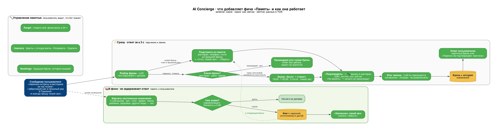
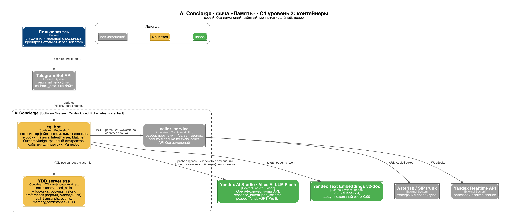
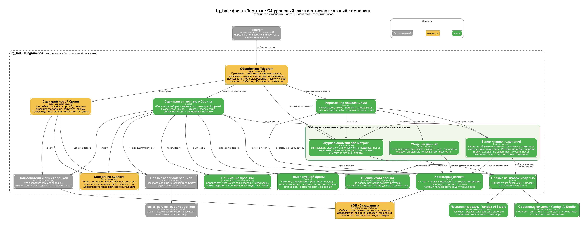
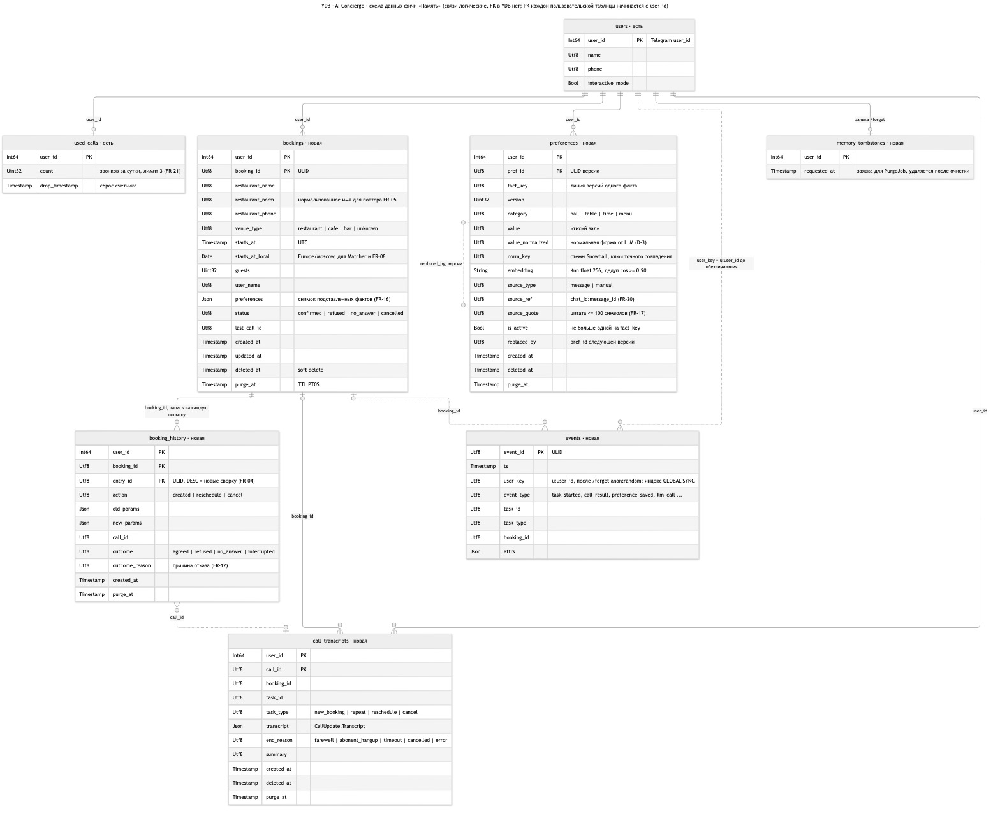

# Диаграммы фичи «Память»

Все диаграммы собраны по [design.md](../design.md). Цвета везде одинаковые: серый — без изменений, жёлтый — меняется, зелёный — новое.

| Файл | Что показывает | Как перерисовать |
|---|---|---|
| [FLOW_memory_overview](FLOW_memory_overview.png) | Краткий флоу для объяснения продукта: что происходит сразу (поручение и звонок), что в фоне (память о пользователе) и как пользователь управляет памятью | `dot -Tpng -Gdpi=150 FLOW_memory_overview.dot -o FLOW_memory_overview.png` |
| [C4_1_containers](C4_1_containers.png) | C4 уровень 2: контейнеры системы и внешние сервисы, что меняется и что добавляется | `dot -Tpng -Gdpi=150 C4_1_containers.dot -o C4_1_containers.png` |
| [C4_2_tgbot_components](C4_2_tgbot_components.png) | C4 уровень 3: компоненты внутри tg_bot и за что каждый отвечает, включая фоновых помощников | `dot -Tpng -Gdpi=150 C4_2_tgbot_components.dot -o C4_2_tgbot_components.png` |
| [ER_ydb_memory](ER_ydb_memory.png) | Схема данных YDB: существующие и новые таблицы, колонки, ключи, логические связи | `npx -y @mermaid-js/mermaid-cli -i ER_ydb_memory.mmd -o ER_ydb_memory.png -b white -s 2` |

Рядом с каждой картинкой лежит `.svg` и исходник (`.dot` для Graphviz, `.mmd` для Mermaid).

## Как работает память

## Контейнеры

## Компоненты tg_bot

## Схема данных

